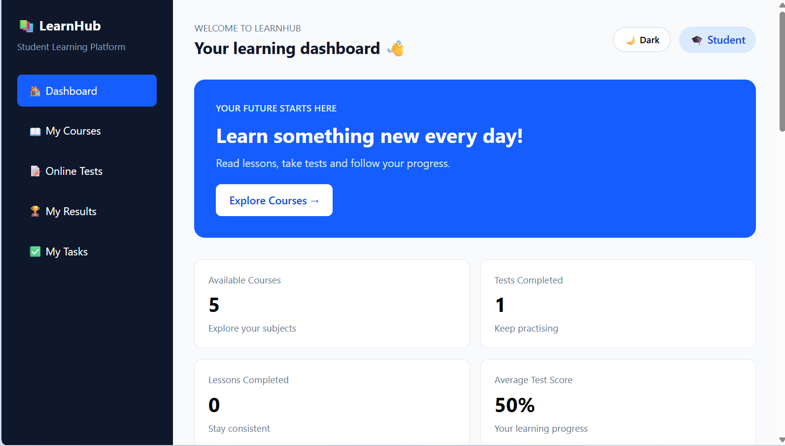
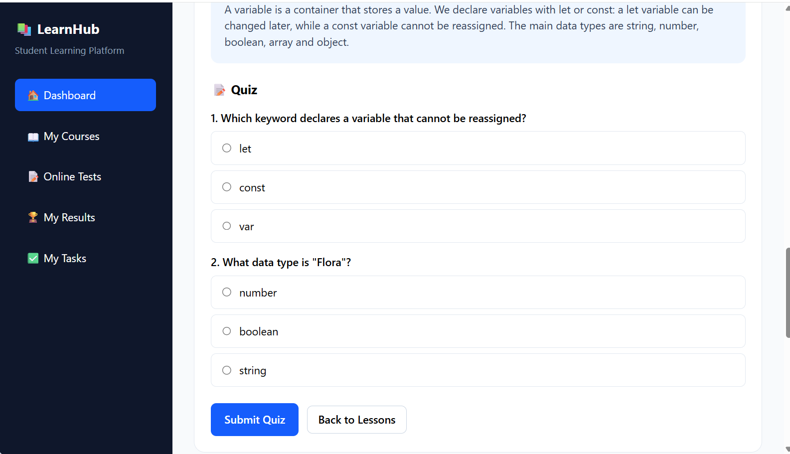
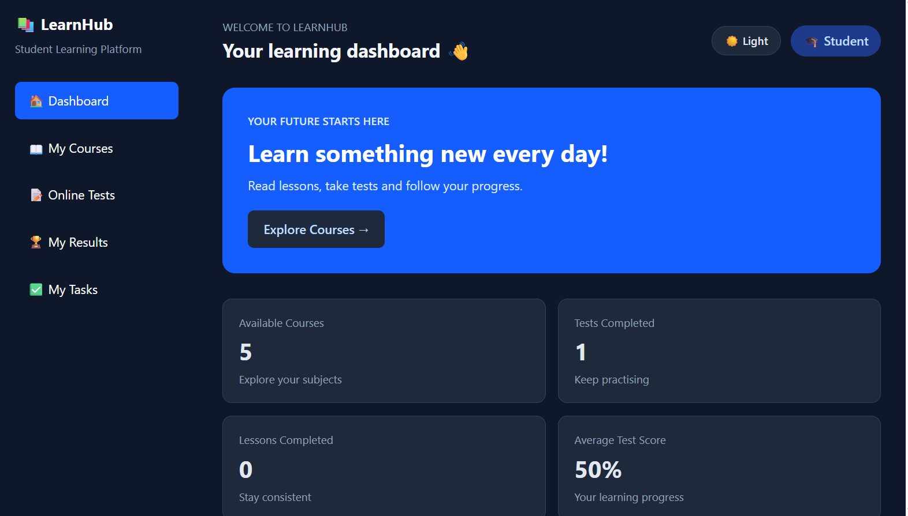

# 📚 LearnHub – Student Learning Platform

LearnHub is a simple online learning platform where students can study lessons, take quizzes, track their progress and organise their study tasks.

**🔗 Live demo:** https://YOUR-LINK.vercel.app



## Features

- **5 courses:** JavaScript Fundamentals, Mathematics, Physics, Biology and Chemistry
- **Course search:** filter courses by title or category (for example "bio" or "science")
- **Lessons with quizzes:** read a lesson, then take its quiz
- **Automatic progress:** a lesson is completed only when all quiz answers are correct
- **My Results:** keeps every quiz attempt with its score
- **Dashboard stats:** courses, tests taken, lessons completed and average score
- **My Tasks:** add, complete, delete, filter (All / Active / Completed) and clear completed study tasks
- **Dark mode:** switch between light and dark themes; your choice is remembered
- **Saved data:** progress, results, tasks and theme are stored in the browser with localStorage
- **Responsive design:** works on phones, tablets and desktops

## Screenshots

| Dashboard | Quiz |
| --- | --- |
|  |  |

| My Tasks | Dark mode |
| --- | --- |
|  |  |

## Built with

- HTML
- Tailwind CSS v4
- Vanilla JavaScript
- Vite
- Deployed on Vercel

## Run it locally

```bash
git clone https://github.com/YOUR-USERNAME/student-learning-platform.git
cd student-learning-platform
npm install
npm run dev
```

Then open http://localhost:5173 in your browser.

## Project structure

```
student-learning-platform/
├── screenshots/     # images used in this README
├── src/
│   ├── main.js      # courses data, rendering, quiz, tasks, search and theme logic
│   └── style.css    # Tailwind import and dark mode styles
├── index.html
├── package.json
└── vite.config.js
```

## How to add a new course

Open `src/main.js` and add a new object to the `courses` array with an `id`, `title`, `category`, `color`, `icon` and a list of `lessons`. Each lesson has a `title`, `duration`, `content` and a `quiz` (questions, options and the index of the correct answer). Progress, stats and search update automatically.

## Known limitations

- Data is stored in the browser (localStorage), so it is not shared between devices.
- There are no user accounts or backend yet.

## Future improvements

- More lessons in every course
- User accounts and a database
- Timed quizzes and certificates

## Author

Iradukunda Flora